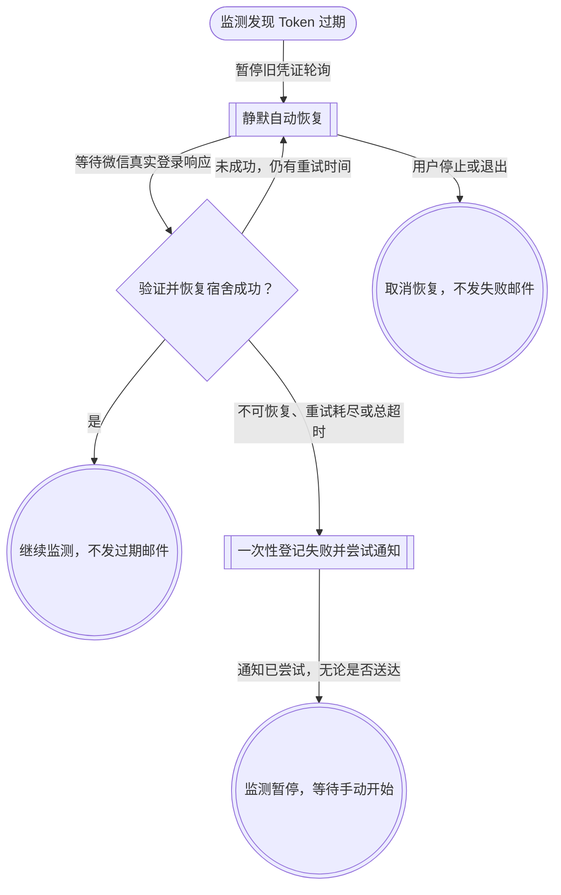

# 变更日志

# v1.7.1 · Token 静默恢复修复版

发布日期：2026-10-28。

## 修复问题

此前监测线程发现 Token 过期，会先发送异常邮件，再交给微信自动刷新，导致刷新成功也收到不必要的报警。本版将过期检测与最终失败通知分开。

- 过期后静默刷新，成功继续监测，不发送 Token 过期邮件。
- 自动更新不可用、两次唤起等待耗尽或总恢复超过 5 分钟时，才提交一次失败通知，并暂停监测。
- 失败状态先登记、再异步发送；重复超时/失败事件不会重复发信。邮件发送异常也不自动重试。
- 暂停后清除运行意图、候选恢复标记和唤起计时，迟到的新 Token 不会让监测自行重启。
- 手动停止、改凭证、退出会取消恢复；新登录成功但原宿舍无效时，不误报登录失效。
- 如已保存自动连接授权且证书受信任，可在恢复过程中尝试重新接入同步。

普通网络异常、水电阈值、固定时间提醒和 30 分钟最低查询间隔保持原逻辑。

## 状态流程

## 升级

退出 v1.7.0，将覆盖升级包解压到原程序目录；保留原配置和证书。独立 EXE 启动器及内置 HTTPS 引擎沿用，更新外置业务模块。完整包不含个人配置、Token、同步数据或证书私钥。
