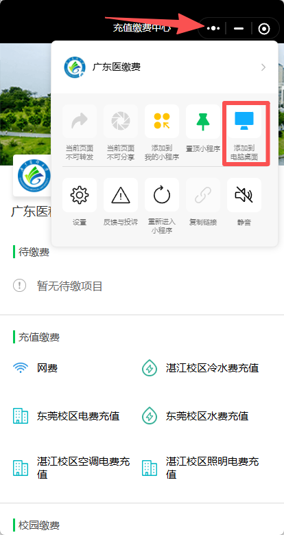

# 广东医 · 宿舍水电 v1.7.1

## 首次使用

### 1. 解压并启动软件

完整解压程序包，运行其中的 EXE。EXE 同级保留 `app`、`_internal` 和 `runtime` 文件夹。

### 2. 创建微信小程序桌面快捷方式

在 **Windows 微信**中登录自己的账号，打开“广东医缴费”小程序。点击小程序窗口右上角的 **“⋯”**，选择 **“添加到电脑桌面”**：

桌面出现“广东医缴费”快捷方式后，先关闭小程序窗口，再双击该快捷方式，确认能直接打开正确的小程序。软件需要的是这个小程序的 `.lnk` 或 `.url` 快捷方式，普通微信主程序图标不能替代它。

如果当前微信版本未提供该入口，可先手动打开小程序查询；要自动唤起刷新 Token，需要可用的小程序桌面快捷方式。不要自行拼造登录链接或登录 code。

### 3. 在软件中保存自动打开设置

进入“微信连接”页面的“小程序自动打开”区域：

1. 点击 **“选择快捷方式”**，选择刚创建的“广东医缴费”桌面快捷方式。
2. 勾选 **“登录过期时自动打开小程序”**。
3. 建议保留 **“获取登录后关闭本次小程序窗口”**，让下一次唤起能重新打开小程序，减少仅置顶旧窗口而未产生新登录请求的情况。
4. 点击 **“保存连接设置”**。

### 4. 连接微信并选择宿舍

点击 **“连接并获取登录”**，按界面提示准备引擎、确认安装本目录专用证书并接入本地代理。软件会尝试通过已保存的快捷方式打开小程序；按需要在微信中完成学校登录或进入水电查询页。

收到并验证新 Token 后，软件自动加载宿舍列表。依次选择校区、楼栋、房间，选完立即保存并查询。

### 5. 开始监测并按需开启下次自动续接

在“监测设置”调整通知方式、阈值和间隔，点击固定底栏 **“保存监测设置”**，回总览点击 **“开始监测”**。默认 Windows 通知，不需要邮箱。

如需重新打开软件后自动续接，在“监测设置 → 下次运行”勾选 **“保存登录凭证和邮件授权码”**、**“打开软件后自动连接微信”** 和 **“打开软件后自动开始监测”**，再保存。应先完成本目录证书与连接配置。

自动刷新使用真实微信登录响应：打开快捷方式后，只有收到并验证新 Token 才算刷新成功；单纯打开或置顶窗口不等于更新成功。微信需保持可登录状态，必要时仍需手动进入查询页。

## 下次打开

软件会校验已保存的登录，自动加载最新列表，按 ID 恢复上次宿舍并查询。名称相同或顺序变化不影响匹配；原宿舍不存在时要求重新选择。

如需尽量自动续上，先在“微信连接”选择有效小程序快捷方式、勾选过期时自动打开并保存；在“监测设置→下次运行”选择保存凭证、自动连接微信、自动监测。自动监测等待登录和宿舍恢复完成。

这些选项只在打开本软件后生效，不会设置 Windows 开机启动。微信仍可能需要人工完成学校登录或进入查询页；本版不自动点击小程序内部页面。

## 页面分工

- **水电总览**：选宿舍、查看水电和时间、刷新、开始/停止监测。
- **微信连接**：首次连接、过期登录、快捷方式及关闭小程序；Token/内部编号/恢复网络位于折叠的高级区。
- **监测设置**：通知通道、规则、可选 SMTP、下次运行。勾选邮件后才显示 SMTP；保存按钮固定在底部。运行中修改规则需先到总览停止监测。
- **运行记录**：查看最近查询、登录、通知及代理处理结果。

## 监测与保存

自动查询、网络失败后的重试最低 30 分钟。水/电阈值留空可忽略该项；每天提醒时间使用 `08:00, 20:00`。固定时间在两次查询之间时，使用上一次成功读数，并标出实际查询时间。每轮余量通知与低阈值警告合并处理。

Windows 可能因免打扰或通知设置不显示横幅；可用“测试 Windows 通知”检查。本版保留原生 Windows 通知；最小化继续监测，退出/休眠不能监测。停止后即使收到新 Token，也保持手动停止。

宿舍 ID/名称保存在 EXE 同级 `.env`，与邮箱配置无关。勾选保存凭证时，`.env` 也包含明文 Token、SMTP 授权码。不要分享 `.env`、`data`、`token-sync`。升级前退出旧程序，避免旧目录仍占用代理。

## Token 过期时的处理（本版修复）

监测中发现 Token 过期，先暂停旧凭证的轮询，静默自动恢复，不立即发送过期邮件或异常桌面通知。

1. 检查自动同步、过期自动打开、小程序快捷方式及同步连接。
2. 接入已开启时自动唤起小程序；断开时仅根据已经保存的“自动连接微信”授权尝试重接入。不会静默安装证书。
3. 保留两次唤起、每次 90 秒等待机会；整个恢复事务最长 5 分钟，包含重接入、候选验证及宿舍恢复时间。
4. 新 Token 验证、原宿舍查询成功后继续原监测，本轮不发送 Token 过期邮件。
5. 条件不可用、自动唤起失败、等待耗尽或超过总时限后，只尝试发送一次失败邮件，随后保持暂停。若启用 Windows 通知，也只在失败后提示一次。
6. SMTP 未配置、关闭邮件或发送失败时，监测仍保持暂停；不会为了重发异常邮件自动恢复轮询。

手动停止、修改 Token 或退出会取消当前恢复事务。失败后迟到的新 Token 可以保存和加载宿舍，但不会自动重新开始监测；需处理后手动开始。主动重新开始监测是一次新的运行意图，可能产生新的恢复尝试。

为使用自动恢复，请提前配置有效快捷方式，勾选过期自动打开并连接同步。若希望断线时重新接入，保存“打开软件后自动连接微信”。未开启自动恢复所需条件时会明确记录原因并暂停。

普通网络错误、低阈值和定时水电通知规则保持不变。新登录成功但原宿舍不再存在时，只要求重新选房，不误发 Token 过期邮件。

## 升级

v1.7.0 用户退出旧软件后，将升级包解压覆盖到原程序目录。保留自己的 `.env`、`data`、`token-sync` 和提醒去重记录；升级包不会包含或覆盖这些运行数据。

新用户完整解压程序包运行。直接换到新的完整包目录使用，需要在新目录完成首次证书接入；要沿用原目录配置和证书，使用覆盖升级包。

版本改动见[变更记录](../CHANGELOG.md)，离线验证方法见[贡献指南](../CONTRIBUTING.md)。实际微信登录、学校查询和邮件送达取决于本机环境及服务状态。

## 常见问题

| 现象 | 检查方法 |
|---|---|
| 快捷方式打不开小程序 | 先确认 Windows 微信已登录；重新从小程序菜单创建快捷方式并在软件里重新选择 |
| 换了目录或删除了快捷方式 | 快捷方式路径变化后，重新选择并保存连接设置 |
| 自动唤起只把旧窗口置顶 | 检查“获取登录后关闭本次小程序窗口”；必要时关闭旧窗口后重新连接 |
| 小程序已打开但没有刷新 Token | 在小程序完成学校登录或进入查询页，检查运行记录中是否收到并验证新登录响应 |
| 没有桌面通知 | 检查 Windows 通知权限和免打扰，使用软件中的测试通知功能 |
| 启动提示缺少模块 | 完整解压程序包，保留 EXE 同级 app、_internal 和 runtime；不要只复制 EXE |

仍需帮助时见[支持说明](../SUPPORT.md)。提交问题前遮挡个人信息和凭证。
